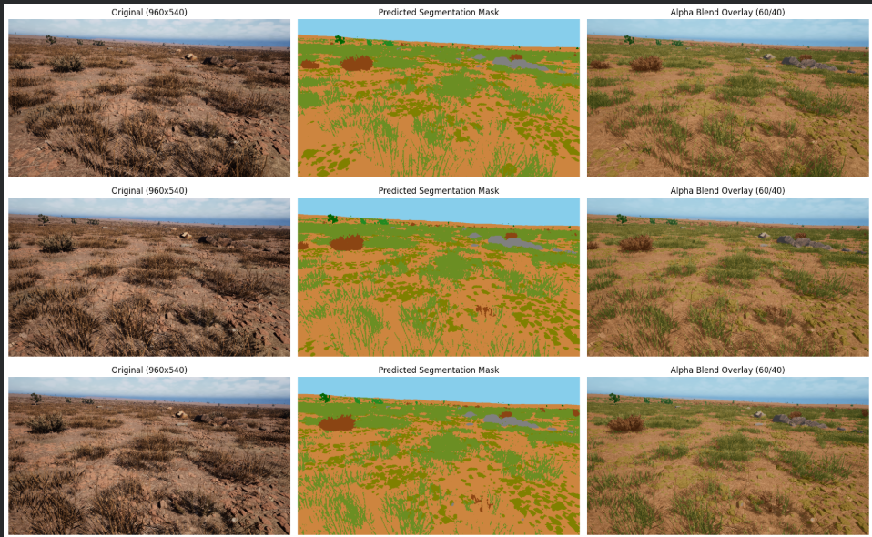

<div align="center">

# 🏜️ Off-Road Semantic Segmentation

### Autonomous Scene Understanding for Unstructured Desert Terrain

[](https://www.python.org/)
[](https://pytorch.org/)
[](https://github.com/qubvel-org/segmentation_models.pytorch)
[](LICENSE)
[](https://colab.research.google.com/)

*High-resolution semantic segmentation pipeline achieving **71.70% mIoU** on 11 navigational terrain classes — a **+30 point** improvement over standard cross-entropy baselines — trained on Falcon simulation data for autonomous ground vehicles (AGVs) navigating semi-arid desert environments.*

</div>

---

## 🎯 Visual Results

<div align="center">



<sub><b>Left:</b> Raw camera input (960×540) &nbsp;|&nbsp; <b>Center:</b> Predicted semantic mask &nbsp;|&nbsp; <b>Right:</b> 60/40 alpha blend overlay</sub>

</div>

---

## 📊 Performance Comparison

| Metric | Standard CE Baseline | **Our Pipeline** | Δ Gain |
|:---|:---:|:---:|:---:|
| **Validation mIoU** | ~41.2% | **71.70%** | **+30.5** |
| Sky | ~88% | **98.92%** | +10.9 |
| Landscape / Dirt Trail | ~65% | **73.85%** | +8.9 |
| Trees | ~72% | **90.16%** | +18.2 |
| Lush Bushes | ~38% | **74.88%** | +36.9 |
| Dry Grass | ~35% | **72.95%** | +37.9 |
| Dry Bushes | ~18% | **54.38%** | +36.4 |
| Ground Clutter | ~12% | **48.97%** | +37.0 |
| Flowers | ~15% | **73.33%** | +58.3 |
| Logs | ~8% | **69.84%** | +61.8 |
| Rocks | ~10% | **59.71%** | +49.7 |

> **Key result:** Lovász-Softmax + Dice + Focal/CE composite loss with EMA weight tracking and rare-class sample weighting enables reliable obstacle isolation even for sparse hazard categories.

### 🔍 Error Analysis — Top Confusions

Dominant misclassification patterns on the validation set (% of true-class pixels predicted as another class):

| True Class | → Predicted As | Confusion % | Analysis |
|:---|:---|:---:|:---|
| Ground Clutter | → Landscape/Dirt | 25.2% | Textural similarity on sandy substrate |
| Dry Bushes | → Dry Grass | 12.9% | Desiccated vegetation overlap |
| Rocks | → Landscape/Dirt | 12.6% | Partially buried / color-matched rocks |
| Rocks | → Dry Grass | 10.3% | Small rock clusters in grassy terrain |
| Landscape/Dirt | → Dry Grass | 9.9% | Transitional terrain boundary |
| Ground Clutter | → Dry Grass | 9.3% | Low-lying debris vs. grass texture |
| Logs | → Landscape/Dirt | 7.7% | Fallen wood on dirt surface |
| Dry Grass | → Landscape/Dirt | 7.4% | Sparse grass / exposed soil |
| Dry Bushes | → Landscape/Dirt | 5.9% | Low scrub on trail edges |
| Flowers | → Landscape/Dirt | 5.3% | Isolated blooms in open terrain |
| Lush Bushes | → Dry Grass | 5.1% | Seasonal vegetation transition |
| Logs | → Dry Grass | 4.7% | Decomposing wood / grass boundary |

> **Insight:** The hardest confusions occur between semantically adjacent terrain classes (e.g., Ground Clutter ↔ Landscape/Dirt). From a navigation safety perspective, the critical chassis-hazard classes (Rocks, Logs) maintain **59.7%** and **69.8%** IoU respectively — sufficient for reliable avoidance planning.

---

## 🗺️ 11-Class Taxonomy & Navigational Impact Matrix

| ID | Class | Color | Nav Impact | Traversal Policy |
|:---:|:---|:---:|:---|:---|
| 0 | **Background / Void** | ⬛ Black | — | Ignore (annotation artifact) |
| 1 | **Trees** | 🟤 Dark Green | 🔴 Hard obstacle | Full avoidance — canopy & trunk collision |
| 2 | **Lush Bushes** | 🟢 Forest Green | 🟠 Soft obstacle | Slow traversal; potential entanglement |
| 3 | **Dry Grass** | 🫒 Olive | 🟡 Mild terrain | Passable — minor traction variation |
| 4 | **Dry Bushes** | 🟫 Saddle Brown | 🟠 Soft obstacle | Slow traversal; branch snag risk |
| 5 | **Ground Clutter** | 🫒 Olive Drab | 🟡 Mild penalty | Passable loose debris |
| 6 | **Flowers** | 🌸 Pink | 🟡 Mild penalty | Passable — conservation-aware slowdown |
| 7 | **Logs** | 🟫 Sienna | 🔴 Chassis hazard | **Hard avoidance** — undercarriage strike |
| 8 | **Rocks** | ⬜ Gray | 🔴 Chassis hazard | **Hard avoidance** — wheel/axle damage |
| 9 | **Landscape / Dirt** | 🟠 Sandy Brown | 🟢 Drivable | **Primary navigation corridor** |
| 10 | **Sky** | 🔵 Sky Blue | ⚪ Boundary | Horizon reference — attitude estimation |

---

## 🏗️ Architecture

```
 ┌───────────────────────────────────────────────────────────────────────────────┐
 │                    OFF-ROAD SEGMENTATION PIPELINE                            │
 └───────────────────────────────────────────────────────────────────────────────┘

  ┌─────────────────┐    ┌──────────────────────┐    ┌──────────────────────────┐
  │  High-Res Input  │    │  Encoder Backbone     │    │  U-Net Decoder           │
  │   544 × 960 RGB  │───▶│  SegFormer MiT-B3     │───▶│  Feature Fusion &        │
  │  (÷32 aligned)   │    │  (ImageNet pretrained) │    │  Skip Connections        │
  └─────────────────┘    └──────────────────────┘    └────────┬─────────────────┘
                                                              │
                          ┌───────────────────────────────────┘
                          ▼
  ┌──────────────────────────────────────────────────────────────────────────────┐
  │                         COMPOSITE LOSS                                      │
  │  ┌──────────────┐   ┌──────────────────┐   ┌──────────────────┐            │
  │  │ Lovász-Softmax│ + │ Cross-Entropy    │ + │ 0.5 × Dice Loss  │            │
  │  │ (mIoU proxy)  │   │ (pixel-wise CE)  │   │ (region overlap)  │            │
  │  └──────────────┘   └──────────────────┘   └──────────────────┘            │
  └────────────────────────────────┬─────────────────────────────────────────────┘
                                   │
                                   ▼
  ┌──────────────────────────────────────────────────────────────────────────────┐
  │  TRAINING DYNAMICS                                                          │
  │  ┌────────────────┐  ┌──────────────────┐  ┌──────────────────────────────┐ │
  │  │ AdamW Optimizer │  │ Cosine Annealing  │  │  EMA Shadow (decay=0.999)   │ │
  │  │ (diff. LR:      │  │ + Linear Warmup   │  │  ema.update(model) each     │ │
  │  │  enc=6e-5       │  │ LambdaLR schedule  │  │  optimizer step             │ │
  │  │  dec=6e-4)      │  │                    │  │                             │ │
  │  └────────────────┘  └──────────────────┘  └──────────────────────────────┘ │
  │  ┌──────────────────────────────┐  ┌─────────────────────────────────┐      │
  │  │ AMP FP16 Mixed Precision     │  │ WeightedRandomSampler            │      │
  │  │ (GradScaler + autocast)      │  │ (rare class boost: 4,5,6,7,8)   │      │
  │  └──────────────────────────────┘  └─────────────────────────────────┘      │
  └──────────────────────────────────────────────────────────────────────────────┘
                                   │
                                   ▼
  ┌──────────────────────────────────────────────────────────────────────────────┐
  │                        INFERENCE (TTA)                                      │
  │                                                                             │
  │  Multi-Scale:  0.75× ──┐                                                   │
  │                1.00× ──┼── Softmax Accumulate ──▶ Argmax ──▶ NN Resize     │
  │                1.25× ──┘      + H-Flip                       960 × 540     │
  │                                                                             │
  │  Output: Single-channel 8-bit PNG class-index mask                          │
  └──────────────────────────────────────────────────────────────────────────────┘
```

---

## 📁 Repository Structure

```
offroad-semantic-segmentation/
├── .gitignore                  # Excludes *.pth, datasets, caches
├── requirements.txt            # Pinned dependencies
├── README.md                   # ← You are here
├── assets/
│   ├── README.md               # Asset placement instructions
│   └── demo_overlay.png        # 3-panel visual showcase
├── checkpoints/
│   ├── .gitkeep                # Preserves directory in Git
│   └── README.md               # Weight download instructions
├── notebooks/
│   └── README.md               # Colab notebook placement guide
└── src/
    ├── __init__.py
    ├── dataset.py              # OffroadDataset, augmentations, sampler weights
    ├── model.py                # Model builder, HybridSegLoss, EMA, checkpoint loader
    ├── evaluate.py             # CLI: confusion matrix & per-class IoU evaluation
    └── inference.py            # CLI: multi-scale TTA batch mask inference
```

---

## 🚀 Quickstart

### 1. Environment Setup

```bash
# Clone the repository
git clone https://github.com/siddhartha-lala/offroad-semantic-segmentation_v2.git
cd offroad-semantic-segmentation_v2

# Create virtual environment
python -m venv venv
source venv/bin/activate        # Linux/macOS
# venv\Scripts\activate         # Windows

# Install dependencies
pip install -r requirements.txt
```

### 2. Evaluate on Validation Set

```bash
python -m src.evaluate \
    --img-dir  path/to/val/Color_Images \
    --mask-dir path/to/val/Segmentation \
    --checkpoint checkpoints/best_miou_model_v2.pth \
    --batch-size 4
```

<details>
<summary>📋 Expected output</summary>

```
╔════════════════════════════════════════════╗
║       Per-Class IoU Breakdown              ║
╠════════════════════════════════════════════╣
║  Background              n/a (not in GT)   ║
║  Trees                          90.16%     ║
║  Lush Bushes                    74.88%     ║
║  Dry Grass                      72.95%     ║
║  Dry Bushes                     54.38%     ║
║  Ground Clutter                 48.97%     ║
║  Flowers                        73.33%     ║
║  Logs                           69.84%     ║
║  Rocks                          59.71%     ║
║  Landscape/Dirt                 73.85%     ║
║  Sky                            98.92%     ║
╠════════════════════════════════════════════╣
║  Overall mIoU                   71.70%     ║
╚════════════════════════════════════════════╝
```
</details>

### 3. Batch Mask Inference (with TTA)

```bash
python -m src.inference \
    --input-dir  path/to/test/Color_Images \
    --output-dir predicted_masks \
    --checkpoint checkpoints/best_miou_model_v2.pth \
    --scales 0.75 1.0 1.25
```

Output masks are single-channel 8-bit PNGs at 960×540 (nearest-neighbour resize).

---

## 🔬 Technical Details

### Loss Function

The composite loss directly optimises the mIoU metric while maintaining stable gradients:

$$\mathcal{L} = \underbrace{\mathcal{L}_{\text{Lovász}}}_{\text{mIoU surrogate}} + \underbrace{\mathcal{L}_{\text{CE}}}_{\text{pixel-wise}} + 0.5 \cdot \underbrace{\mathcal{L}_{\text{Dice}}}_{\text{region overlap}}$$

### Training Configuration

| Parameter | Value |
|:---|:---|
| Encoder | SegFormer MiT-B3 (ImageNet) |
| Decoder | U-Net |
| Resolution | 544 × 960 (÷32 aligned, ≈16:9) |
| Batch Size | 4 × 2 gradient accumulation = 8 effective |
| Optimizer | AdamW (enc: 6e-5, dec: 6e-4, wd: 1e-2) |
| Schedule | Linear warmup → Cosine annealing |
| EMA Decay | 0.999 |
| Precision | AMP FP16 (GradScaler) |
| Epochs | 40 |
| Hardware | Google Colab T4 GPU (16 GB VRAM) |

### Test-Time Augmentation

Multi-scale TTA at **0.75×**, **1.0×**, and **1.25×** with horizontal flipping accumulates 6 softmax predictions, then takes the argmax for robust boundary delineation and minority-class recall.

---

## 📄 License

This project is licensed under the **MIT License** — see [LICENSE](LICENSE) for details.

---

<div align="center">

*Built for autonomous ground vehicles navigating the unknown.*

</div>
